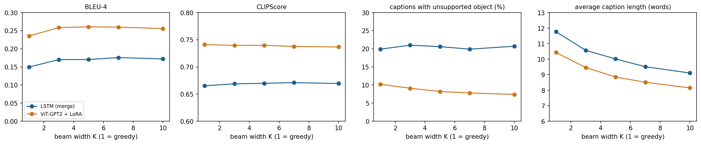
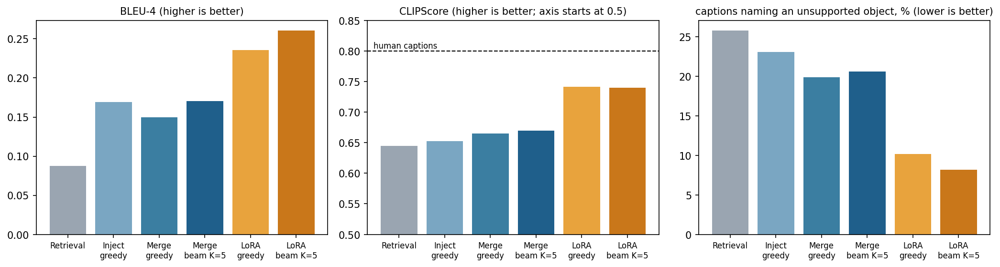
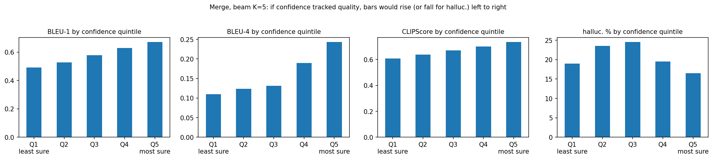
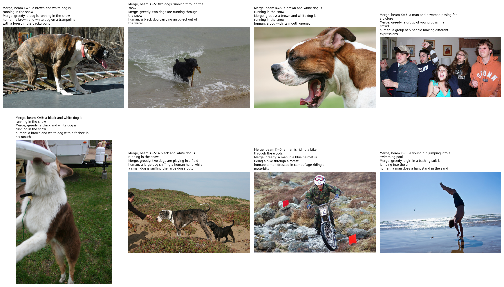

# Pixels to Sentences: A Closer Look at Decoding in Image Captioning

An image captioning system on Flickr8k. The project is less about building the best captioner and more about two questions: **how we decode** (greedy vs. beam search vs. sampling) and **how we evaluate** (BLEU vs. CLIPScore vs. the model's own confidence).

## Key findings

- **Beam search raises BLEU, not much else.** BLEU-4 goes from 0.150 (greedy) to 0.170–0.176 (+13–17%, significant). CLIPScore improves by under 1% and the share of captions naming an unsupported object stays at about 20%. Captions get shorter and less varied.
- **Confidence tracks image fit moderately but cannot spot wrong objects.** Correlation with CLIPScore is 0.41–0.48, but flagging captions with unsupported objects is at chance (AUROC 0.51–0.54). Wider beams make confidence a weaker signal.
- **CLIPScore is a useful complement to BLEU.** It detects captions with unsupported objects best (AUROC 0.69–0.75 vs. 0.57–0.65 for BLEU).
- **The same decoding story holds on a much stronger model** (a ViT + GPT-2 captioner adapted with LoRA).
- **Sampling hurts accuracy**, and a simplified contrastive search gives the lowest unsupported-object rate.

## Research questions

1. **RQ1.** Does beam search produce better captions than greedy decoding, and does it depend on beam width?
2. **RQ2.** Does the model's own confidence (log-probability) tell us how good a caption is? Can low confidence flag "confidently wrong" captions?
3. **RQ3.** Is CLIPScore a useful evaluation signal next to BLEU?
4. **Extensions.** Other decoders, and a LoRA-adapted pretrained model as a robustness check.

## Workflow

1. **Data.** Flickr8k (6,000 train / 1,000 dev / 1,000 test images, 5 captions each). Captions are lowercased, stripped of punctuation and wrapped in start/end markers. Vocabulary: words seen at least 10 times (8,828 → 1,659 types). 339,484 training pairs.
2. **Image features.** Each image goes once through a frozen InceptionV3 (2048 numbers), cached and standardised.
3. **Word vectors.** Frozen 200-d GloVe (covers 1,650 of 1,659 words).
4. **Models.**
   - **Merge LSTM (main):** image and text processed separately, combined near the end (1.55M trainable parameters).
   - **Inject LSTM (baseline):** the image sets the LSTM's initial state.
   - **Retrieval baseline:** copies a caption of the most similar training image.
   - **LoRA ViT-GPT-2 (robustness check):** a pretrained captioner adapted with LoRA (958,464 of 240M parameters trained, 0.4%).
5. **Decoding.** Greedy, beam search (K = 3, 5, 7, 10, with and without length normalisation), temperature / top-k / top-p / min-p sampling, and a simplified contrastive search.
6. **Evaluation (1,000 test images).**
   - BLEU-1..4 (corpus and per sentence).
   - CLIPScore (image–caption fit, reference-free).
   - Unsupported-object check: a caption is flagged if it names an object group (dog, boat, snow, ...) that none of the 5 human captions mention.
   - Confidence: total and per-word log-probability.
   - Statistics: paired Wilcoxon tests per image, Spearman with bootstrap intervals, AUROC.

## Results




### LSTM family

| Method | BLEU-1 | BLEU-4 | CLIPScore | Unsupported obj. % | Avg words | Distinct % |
|---|---|---|---|---|---|---|
| Retrieval baseline | 0.445 | 0.088 | 0.644 | 25.8 | 11.0 | 85.6 |
| Inject, greedy | 0.582 | 0.169 | 0.652 | 23.1 | 10.6 | 69.3 |
| Merge, greedy | 0.532 | 0.150 | 0.665 | 19.9 | 11.8 | 86.6 |
| Merge, beam K=3 | 0.577 | 0.170 | 0.669 | 21.0 | 10.6 | 83.0 |
| Merge, beam K=5 | 0.583 | 0.170 | 0.670 | 20.6 | 10.0 | 80.8 |
| Merge, beam K=7 | 0.598 | 0.176 | 0.671 | 19.9 | 9.5 | 79.8 |
| Merge, beam K=10 | 0.596 | 0.172 | 0.669 | 20.7 | 9.1 | 77.6 |
| Merge, beam K=5 + length norm | 0.559 | 0.168 | 0.667 | 25.9 | 11.6 | 84.4 |
| Sampling, temperature 0.7 | 0.493 | 0.102 | 0.645 | 24.1 | 11.1 | 99.7 |
| Sampling, temperature 1.0 | 0.426 | 0.067 | 0.623 | 25.7 | 11.2 | 99.9 |
| Top-k sampling, k=10 | 0.462 | 0.075 | 0.639 | 25.5 | 11.3 | 99.9 |
| Top-p sampling, p=0.9 | 0.451 | 0.078 | 0.640 | 24.6 | 11.0 | 99.9 |
| Min-p sampling, p=0.1 | 0.487 | 0.096 | 0.648 | 22.8 | 11.2 | 99.7 |
| Contrastive (simplified) | 0.535 | 0.142 | 0.668 | 17.3 | 8.3 | 84.9 |

Human captions score a CLIPScore of 0.799. The same model captions paired with the wrong image score about 0.44, so CLIPScore does measure image–text fit.

### LoRA ViT-GPT-2

| Method | BLEU-1 | BLEU-4 | CLIPScore | Unsupported obj. % | Avg words | Distinct % |
|---|---|---|---|---|---|---|
| Greedy | 0.664 | 0.235 | 0.741 | 10.2 | 10.4 | 92.2 |
| Beam K=3 | 0.698 | 0.258 | 0.740 | 9.1 | 9.5 | 90.6 |
| Beam K=5 | 0.699 | 0.261 | 0.740 | 8.2 | 8.8 | 89.2 |
| Beam K=7 | 0.694 | 0.260 | 0.738 | 7.8 | 8.5 | 87.7 |
| Beam K=10 | 0.688 | 0.256 | 0.737 | 7.4 | 8.1 | 85.8 |
| Beam K=5 + length norm | 0.680 | 0.253 | 0.740 | 10.9 | 10.6 | 90.3 |
| Sampling, temperature 0.7 | 0.572 | 0.145 | 0.722 | 12.7 | 10.5 | 99.6 |
| Sampling, temperature 1.0 | 0.452 | 0.078 | 0.686 | 14.2 | 10.9 | 100.0 |
| Top-k sampling, k=10 | 0.524 | 0.113 | 0.714 | 14.3 | 11.1 | 100.0 |
| Top-p sampling, p=0.9 | 0.505 | 0.099 | 0.702 | 13.8 | 10.8 | 100.0 |
| Min-p sampling, p=0.1 | 0.578 | 0.137 | 0.722 | 14.1 | 10.8 | 99.9 |

### Does confidence track quality?



| Confidence (mean log-prob per word) vs. | LSTM greedy | LSTM beam K=5 | LSTM beam K=10 | LoRA beam K=5 |
|---|---|---|---|---|
| Sentence BLEU-4 (Spearman) | 0.43 | 0.39 | 0.36 | 0.29 |
| CLIPScore (Spearman) | 0.48 | 0.44 | 0.41 | 0.31 |
| AUROC, flagging low-CLIP captions | 0.73 | 0.70 | 0.68 | 0.67 |
| AUROC, flagging unsupported-object captions | 0.51 | 0.53 | 0.54 | 0.53 |

### Confidently wrong captions



## Findings and reasoning

- **RQ1.** Beam search raises BLEU significantly per image, but only slightly raises CLIPScore. Greedy captions are longer than the closest human caption (11.8 vs 10.7 words) and often loop ("a little boy in a red coat and red jacket is wearing a red coat..."). Beam search removes those loops and prefers common phrases that overlap with the references. It cannot fix visual mistakes (wrong gender, a missed second dog, leaves read as snow), because the image features decide what is recognised. Beyond K=7 captions get shorter and BLEU's brevity penalty starts to bite, so there is no further gain.
- **RQ2.** Confidence correlates moderately with CLIPScore and BLEU, but a caption naming a wrong object is not less confident. In the "confidently wrong" gallery, many dogs are captioned "a dog running in the snow", which looks like a high-probability template. The total beam probability is mostly a caption-length measure (correlation −0.87 with length). Wider beams shrink the spread of confidence (0.225 → 0.169), which fits its weaker link to quality.
- **RQ3.** CLIPScore and BLEU agree on which method is best (rank correlation 0.90) but not on how much better it is (+17% vs. +0.9%). CLIPScore is the better detector of captions with unsupported objects because it is the only signal that sees the image.
- **Unsupported objects and length.** For the LoRA model, the unsupported-object rate rises with caption length (3–5% for 8 words or fewer, 13–17% for 12 or more), so beam search lowers it mostly by making captions shorter. For the LSTM it is roughly flat across lengths.
- **Inject vs. merge.** The inject model has the lower validation loss (2.749 vs. 2.942) and matches merge+beam on corpus BLEU-4, but only 69% of its captions are distinct and its CLIPScore is significantly lower. It leans on generic captions. The merge model overfits quickly (best epoch 3 of 6).
- **Sampling and contrastive search.** Sampling gives near-100% distinct captions but loses 0.05–0.13 BLEU-4 and CLIPScore, because it sometimes picks low-probability words. The simplified contrastive search has the lowest unsupported-object rate (17.3%) with the shortest captions.
- **LoRA.** The LoRA model reaches 93% of the human CLIPScore (0.741 vs. 0.799) and shows the same decoding pattern as the LSTM, so the findings are not an artefact of a weak model.
- **Object categories.** People categories score lowest on CLIPScore (0.63–0.66), with gender, age and clothing errors. Dogs have the highest unsupported-object rate (28%). Some categories have fewer than 60 images, so differences there are noisy.

### Which method is better?

Beam search with K around 5 to 7 is the best all-round choice (top mean rank for both the LSTM and LoRA), but its gain is mostly in word overlap, not in how faithful the caption is to the image. Wider beams add nothing. Sampling is worse on every accuracy metric. Greedy is the cheapest option when BLEU is not the goal.

## Problems encountered and how they were solved

- The original beam search added raw probabilities. It was rewritten with log-probabilities and vectorised on the GPU.
- A 100-image smoke test gave misleading conclusions (e.g. a method-ranking correlation of 0.04 instead of 0.90), so every result here uses the full 1,000-image test set.
- A shared GPU ran out of memory because another job held 5 GB. The notebook now picks the freest GPU, uses batch 8 with gradient accumulation, and can free memory.
- The Stanford GloVe server was blocked from the university network, so GloVe comes from a Hugging Face mirror.
- The inject baseline was initially under-trained, so it was retrained until early stopping.

## Limitations

- One training run and one sampling seed per setting. Significance tests are uncorrected for multiple comparisons.
- BLEU rewards word overlap, and CLIPScore inherits CLIP's biases.
- The unsupported-object check uses hand-made synonym lists, so it is crude, and shorter captions score better on it.
- The inject baseline is an "init-inject" variant, and the contrastive search is a token-level simplification.
- The LoRA base model was pretrained on COCO captions, and its confidence is per sub-word token (the LSTM's is per word).

## Future work

ViT encoder comparison, several seeds, an object-detector-based hallucination metric, a small human evaluation, and a real hidden-state contrastive search.

## How to reproduce

1. Open the notebook on a machine with a CUDA GPU. Run the install cell, then the settings cell (it picks the GPU with the most free memory).
2. Log in to Kaggle (`kaggle auth login`, or a token via the hidden prompt) and run the download cell.
3. Set `SMOKE_TEST = False`, restart the kernel and run all cells top to bottom.
4. Set `RUN_LORA = False` to skip the LoRA part, or `ENCODER = "vit"` to run the ViT encoder.

Tested with Python 3.12 and PyTorch 2.4.1 (CUDA 12.1) on a GTX 1080 Ti. Seed: 42.

Suggested `.gitignore`:

```
data/
cache/
kaggle.json
.ipynb_checkpoints/
```
## References

- Vinyals, Toshev, Bengio, Erhan (2015). *Show and Tell: A Neural Image Caption Generator.* CVPR.
- Berger, Stanovsky, Abend, Frermann (2025). *Surveying the Landscape of Image Captioning Evaluation: A Comprehensive Taxonomy, Trends, and Metrics Analysis.* TACL 13.
- Sharma, Padha (2023). *A Comprehensive Survey on Image Captioning: From Handcrafted to Deep Learning-Based Techniques, a Taxonomy and Open Research Issues.* Artificial Intelligence Review 56.
- Papineni, Roukos, Ward, Zhu (2002). *BLEU: a Method for Automatic Evaluation of Machine Translation.* ACL.
- Pennington, Socher, Manning (2014). *GloVe: Global Vectors for Word Representation.* EMNLP.
- Szegedy et al. (2016). *Rethinking the Inception Architecture for Computer Vision.* CVPR.
- Radford et al. (2021). *Learning Transferable Visual Models From Natural Language Supervision.* ICML.
- Hessel et al. (2021). *CLIPScore: A Reference-free Evaluation Metric for Image Captioning.* EMNLP.
- Hu et al. (2022). *LoRA: Low-Rank Adaptation of Large Language Models.* ICLR.